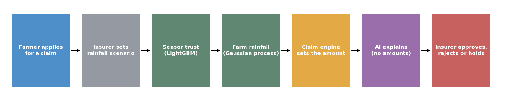
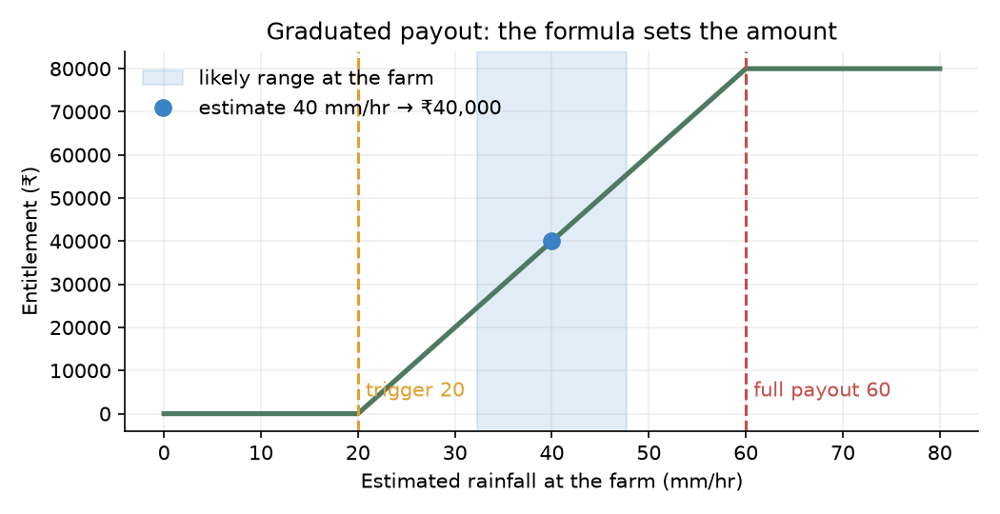
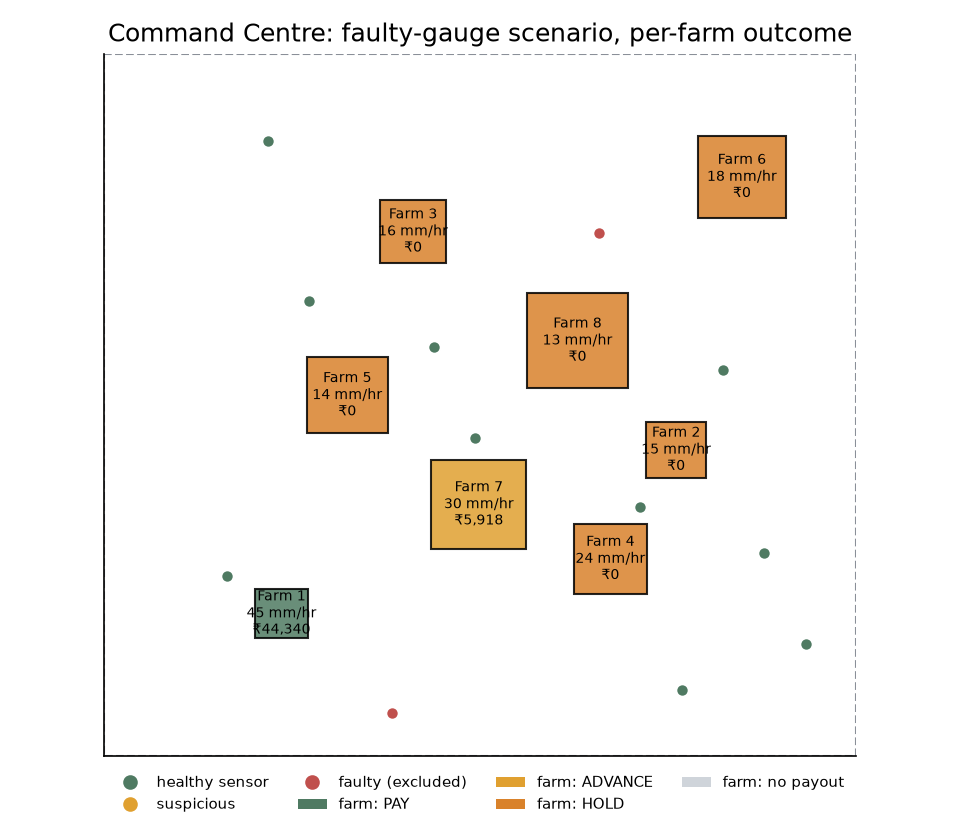
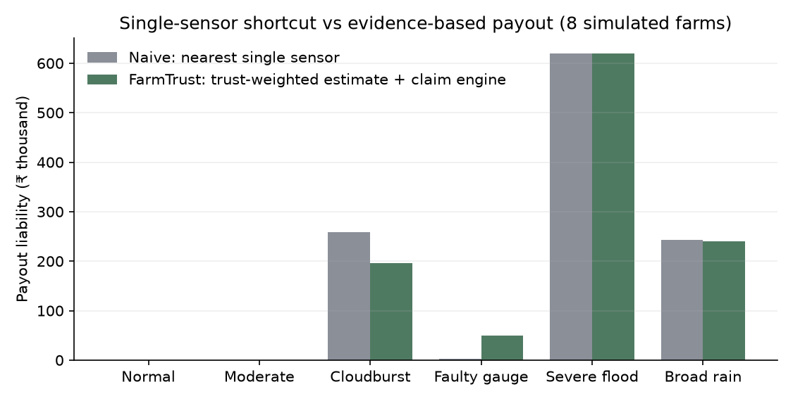

# FarmTrust

Agentic climate insurance intelligence & financial risk platform (B2B2C). All payments are **simulated**. Full plan: [docs/ROADMAP.md](docs/ROADMAP.md).

## How it works



The amount of every claim comes from a graduated formula on the estimated rainfall at the farm. The AI only explains the result, and a person approves, rejects or holds.



A faulty or lying sensor is detected and down-weighted instead of being trusted blindly, and each farm gets its own rainfall estimate with an uncertainty range:





_These charts are generated from the real claim engine and Command Centre evaluator with synthetic farms and simulated weather (`python backend/scripts/make_readme_charts.py`, needs `pip install matplotlib`). They are not screenshots of the running app._

## Structure

```
backend/    FastAPI service (Firebase Auth + Firestore, Cloudinary for images)
  app/api         HTTP routes (auth, farmers, policies, geo, sensors, simulation, risk, claims,
                  command, agents, basis_risk, backtest, premium, my_claims)
  app/core        config, Firebase auth, role dependencies
  app/schemas     Pydantic schemas
  app/services    firestore, cloudinary, geo, simulation, fault_detection (LightGBM),
                  risk (GP/Kriging), era5_loader, command_centre, claims, basis_risk,
                  sensor_forensics, disputes, payments, rwbcis_backtest, agents/
frontend/   React + TypeScript + Vite + MapLibre GL
  src/features    auth, farmer, insurer, auditor, admin, map, simulation, sensors, risk, landing
docs/       roadmap and per-stage notes (docs/stages/)
```

## Run

Credentials and first-time setup: see [SETUP.md](SETUP.md) and [GET_FIREBASE_KEY.md](GET_FIREBASE_KEY.md).
`backend/.env` (gitignored) must hold the Firebase service-account values and `CLOUDINARY_URL`.

**Backend** (from `backend/`):
```bash
python3 -m venv .venv && source .venv/bin/activate
pip install -r requirements.txt
uvicorn app.main:app --reload --reload-dir app --port 8000
```
`--reload-dir app` matters: without it, installing packages into the venv triggers reload storms.

**Frontend** (from `frontend/`):
```bash
npm install && npm run dev
```

| URL | Purpose |
|-----|---------|
| http://localhost:5173 | Landing page |
| http://localhost:5173/login | Sign in |
| http://localhost:5173/register | Farmer registration |
| http://localhost:8000/docs | FastAPI interactive docs |

Roles: farmer, insurer, auditor, admin. Demo insurer/auditor/admin accounts are provisioned on first login (see `DEMO_ROLES` in `frontend/src/api/auth.ts`).

## Stages

| Stage | Name | Status |
|-------|------|--------|
| 1 | Website foundation & user login | ✅ Complete |
| 2 | Farmer & policy management | ✅ Complete |
| 3 | Satellite map & geographic monitoring | ✅ Complete |
| 4 | Weather & flood simulation | ✅ Complete |
| 5 | Sensor fault detection & trust scoring (LightGBM) | ✅ Complete |
| 6 | Farm-level risk assessment (GP/Kriging, ERA5) | ✅ Complete |
| 7 | Four AI agents | 🟡 Built (`/insurer/agents`, `backend/app/services/agents`) |
| 8 | Claim calculation (deterministic engine, approvals) | ✅ Backend complete |
| 9 | Insurer claims review & simulated payments | 🟡 Core flow built (`/insurer/claims`) |
| 10–12 | Farmer tracking, audit, integration & demo | 🟡 Farmer claim views and disputes built; audit and demo polish pending |
| 13 | Farm-level 3D monitoring & rainfall simulation | 🟡 First version built (`/insurer/command`) — [spec & status](docs/stages/13-farm-level-3d-monitoring.md) |
| 14 | Basis risk monitor & sensor forensics | 🟡 Built (`/insurer/basis-risk`, Command Centre sensor panel) — [notes](docs/stages/14-basis-risk-and-sensor-forensics.md) |

Stage notes: [docs/stages/](docs/stages/)

## Recent additions
- **Basis Risk Monitor** (`/insurer/basis-risk`): per-farm indicators of possible under- or over-compensation. Indicators only, never proof; they never create or change a claim.
- **Sensor Forensics Workbench**: click any sensor in the Command Centre for its history, neighbour comparison, rule-based anomaly markers and LightGBM feature contributions.
- **Backtesting** (`/insurer/backtest`), **premium** pricing, **disputes**, and farmer-side claim views (`/farmer/claims`) with farmer loss reports.
- **Claim requests:** a farmer applies for a claim on a farm (dashboard → Apply for claim). The insurer opens it in the Command Centre, sets the simulated rainfall, and the farm-only 3D view shows the AI + formula assessment on the right. The amount comes from the claim engine; the LLM only explains it. Approve/reject creates the claim record; hold keeps the request open. The old farmer "Report damage" card was removed.
- Weather and sensors are simulated; all payments are simulated.

## What was added after Stage 6

**Farm registration with manual boundary tracing** (`/farmer/farms/new`)
- 2D satellite map opening on a bundled example farmland image (`frontend/public/example-farmland.jpg`, geo-referenced) so many field plots are always visible; live Esri tiles sit underneath and a place search (Nominatim) can move the map elsewhere.
- The farmer **manually** traces the boundary: Start Drawing → click corners → Finish Boundary, with undo, clear, redraw and draggable corners. Self-crossing or tiny/huge shapes are rejected.
- Area in hectares is computed from the traced polygon; a review step shows name, location, boundary and area before **Confirm & Save Farm**. The system never auto-detects farms or verifies ownership.

**Persistence**
- Saving stores, in Firestore `farms/{farm_id}`: `farm_id`, `farmer_id` (Firebase uid), `coordinates` (`{lat,lng}` points), `latitude/longitude`, `area_hectares`, `boundary_geojson`, and `image_url` (Cloudinary link; also kept as `map_image_url`).
- A snapshot of the traced map is uploaded to **Cloudinary through the backend** (`POST /api/farmers/farms/{id}/image`); the Cloudinary secret never reaches the browser. If the upload fails the farm is still saved.
- **My Farms** shows each saved farm with its picture and area, and an **Edit boundary** button (`/farmer/farms/:id/edit`, `PUT /api/farmers/farms/{id}`) that reloads the saved polygon for adjusting or redrawing and refreshes the picture.
- A farmer account now creates, at sign-up/login: `users/{uid}`, `farmer_profiles/{uid}` and `farmers/{uid}` (which also tracks `farm_ids`). The backend also auto-creates a missing profile on first farm save.

**Insurer side**
- The Operations Map opens in **3D** (terrain + extruded farm polygons, taller for active policies). Clicking a farm opens its detail panel with the farmer-traced picture.
- The farmer registry/detail pages use string farmer ids from the backend.

**Debugging aids**
- Saving logs each step with timings in the browser console (filter `farm-save`); the backend logs Cloudinary upload timing.

## Known setup notes
- **Firestore hang on some macOS/Python 3.14 setups:** gRPC's default DNS resolver can fail ("Could not contact DNS servers"). `app/__init__.py` sets `GRPC_DNS_RESOLVER=native` before gRPC loads; keep it.
- Firestore rules are currently fully open (development only) — lock them down before any real deployment.
- Registration happens in the browser (Firebase Auth + Firestore); the backend does not see it.

## Next phase
Finish stages 10–12 (audit, financial reconciliation, integration and demo) and harden Firestore rules for deployment.

Full plan: [docs/ROADMAP.md](docs/ROADMAP.md) · Stage notes: [docs/stages/](docs/stages/)
